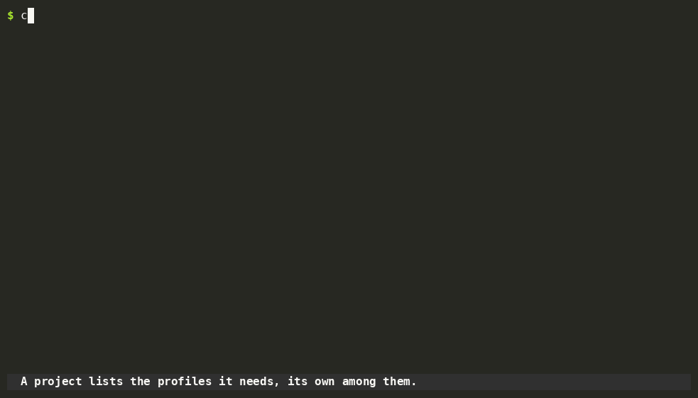
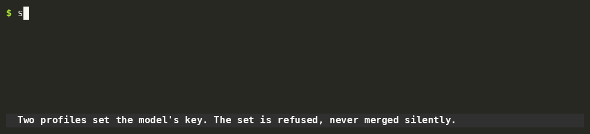

<p align="center"></p>

# sprite-profiles

Pick a few profiles, and a fresh [Fly.io Sprite](https://docs.sprites.dev) gets all of them,
merged by rules that refuse rather than guess.

[](https://github.com/antialias/sprite-profiles/releases/latest)
[](LICENSE)
[](https://github.com/topics/sprite-profile)



## What a profile is

A profile is a small folder that gives a Sprite one thing: an agent, a tool, a connector.

- **What goes inside the Sprite:** what to install, files to push, services to run, and
  Claude Code skills and MCP servers.
- **What is set from outside it:** the network rules and connectors it needs, and the labels
  that admit it to them.
- **What it can touch:** every domain and endpoint it reaches, and whether it holds a
  credential, declared up front and shown before anything runs.

A project lists the profiles it needs in `sprite-profiles.toml`, its own among them:

```toml
profiles = [
  "claude-code",
  "anthropic",
  "@antialias/shop-inventory@1",
  "github-mcp",
  "playwright",
  "preview",
  "./weekend",
]
```

`sprite-profiles launch` in that folder makes a Sprite with all seven.

## Three demos

Each clip was run for real. Pauses over 2 s are cut, and the times on screen are real.

**Compose.** The clip at the top: one command launches a Sprite with the seven profiles above,
and Claude, asked inside it, builds a page. The project's own profile,
[`./weekend`](demo/weekend), brings the task and the permissions Claude needs for it.
[`@antialias/shop-inventory`](https://github.com/antialias/sprite-profile-shop-inventory) is
published by the shop, and the other five ship with sprite-profiles. No key is inside the
Sprite: Fly's gateway adds them on the way out. Script: [`demo/demo.sh`](demo/demo.sh).

<a href="demo/weekend.png"></a>

*What Claude built, screenshotted by Playwright in that Sprite: the top, and the end, where it
reports the Sprite's checks. [The whole page](demo/weekend.png).*

**Swap one profile**, and Claude's model goes through [Apiary](https://apiary.wtf)'s HTTPS
proxy instead of Fly's connector.
[`@antialias/apiary`](https://github.com/antialias/sprite-profile-apiary) enrols the Sprite as
a device that someone approves; the time on its line is mostly that wait.
Script: [`demo/apiary.sh`](demo/apiary.sh).


**Profiles that disagree are refused**, never merged silently. Here two profiles both set
`ANTHROPIC_API_KEY`. Script: [`demo/conflict.sh`](demo/conflict.sh).



## Profiles people have published

A published profile is a public git repository with a conventional name, so nothing is
hosted and anyone can publish one. The vendor of a tool or a service can publish the profile
for it, and its network rules read like an app's permission list: you see what it reaches
before it runs.

| pick | what it gives a Sprite | publisher |
|---|---|---|
| [`@antialias/shop-inventory`](https://github.com/antialias/sprite-profile-shop-inventory) | A woodworking shop's tool inventory over MCP, read-only, through a connector; no key in the Sprite | antialias, for the shop it serves |
| [`@antialias/apiary`](https://github.com/antialias/sprite-profile-apiary) | Claude Code through [Apiary](https://apiary.wtf)'s switch proxy, the Sprite enrolled as a device you approve | antialias |

[Browse the `sprite-profile` topic](https://github.com/topics/sprite-profile) on GitHub, or
run `sprite-profiles search`. Published one? [Add yours](../../issues/new?template=add-profile.yml)
to this table. Missing one? [Ask for it](../../issues/new?template=request-profile.yml).

### Publish yours in three steps

1. **Name a public repository `sprite-profile-NAME`.** People pick it as `@you/NAME`. The
   [template](https://github.com/antialias/sprite-profile-template) has everything in place:
   press "Use this template".
2. **Write `profile.toml` at its root**, with `name = "NAME"`. [Writing a
   profile](docs/WRITING.md) has the format; the template's workflow checks that it resolves
   on every push.
3. **Tag a version and add the topic**, so `sprite-profiles search` finds it:

   ```sh
   git tag -a v1.0.0 -m "NAME 1.0.0" && git push origin v1.0.0
   gh repo edit --add-topic sprite-profile
   ```

[Publishing](docs/PUBLISHING.md) covers versions, collections, monorepos and other git hosts.

## Install, and a 30-second start

Download `sprite-profiles` for your machine from the
[latest release](https://github.com/antialias/sprite-profiles/releases/latest):
`sprite-profiles-macos_arm64`, `sprite-profiles-linux_x86_64` or
`sprite-profiles-linux_arm64`. It carries its own Erlang, so it needs nothing else; launching
a Sprite also needs the [`sprite` command](https://docs.sprites.dev), signed in.

```sh
mv sprite-profiles-macos_arm64 /usr/local/bin/sprite-profiles
chmod +x /usr/local/bin/sprite-profiles
xattr -d com.apple.quarantine /usr/local/bin/sprite-profiles   # macOS: the binary is not notarized
```

Planning needs no Sprite and no token, and the bundled profiles ship inside the binary:

```sh
sprite-profiles plan claude-code playwright          # what a Sprite would get, and from whom
sprite-profiles search shop                          # published profiles on GitHub
sprite-profiles launch claude-code playwright --name demo
sprite-profiles exec demo claude -p "Say hello."     # run something inside
```

| bundled profile | gives a Sprite |
|---|---|
| `claude-code` | Claude Code ready to work unattended: hooks that keep the Sprite awake mid-turn, a pre-trusted `~/work`, and an MCP server that needs no sign-in. No model access of its own |
| `anthropic` | Claude's model through Fly's connector: a custom API connector in your org holds the Anthropic key, and the Sprite holds a placeholder |
| `anthropic-key` | **privileged**: an Anthropic API key, read from your machine at launch |
| `github` | GitHub through Fly's connector gateway, with no token in the Sprite |
| `github-mcp` | GitHub's remote MCP server through a custom API connector you create with `sprite-profiles connect`; inputs pick the toolsets and read-only mode |
| `playwright` | Playwright and Chromium, then a headless page load to prove it works |
| `preview` | a static-file service on the Sprite's own URL |

A profile with a connector needs that connector in your org first; without it, the launch is
refused before anything is created.

[Using profiles](docs/USING.md) goes on from here: picking by name and version, a project's
set and its lock file, and what a launch does. From a checkout, every command is also a Mix
task (Elixir 1.17 or later): `mix profiles.plan -p claude-code` is
`sprite-profiles plan claude-code`.

## Why not a setup script?

You could install all of that with a setup script in a couple of minutes. Profiles are for
the parts a script can't do.

**Part of a Sprite's setup isn't inside the Sprite.** Network policy, connector access and
labels are set through the Sprites API, from outside, where a script in the Sprite can't and
shouldn't reach. A profile declares both halves: picking `github` gives the Sprite a skill,
a network rule for Fly's gateway, and the label the org's GitHub connector admits. That's
GitHub access with no token in the Sprite, as one pick.

**Scripts don't combine; profiles do.** Run two setup scripts and the second one silently
wins. Profiles are declarations, so the whole set is merged and checked before a Sprite
exists, and a disagreement is refused in a sentence that names both profiles. Here `preview`
meets a profile of your own that also serves the Sprite's URL:

```
$ sprite-profiles plan preview docs-site
Refused:
  [http_port_conflict] profiles 'preview' and 'docs-site' both give a service an http_port ('preview' on 8080, 'docs' on 4000); a Sprite routes its URL to one service, so drop http_port from one of them.
```

**Agents get a boundary.** What needs guarding isn't setup but what an agent shouldn't
choose: credentials, network reach and connectors. A profile that holds a credential is
**privileged**. An agent may not launch a set that holds one, and the credential is applied
after the Sprite's checkpoint, so restoring that checkpoint never brings a key back.

```
$ sprite-profiles plan claude-code anthropic-key --agent
Refused:
  [not_for_agents] profile 'anthropic-key' is privileged; an agent may not launch a set that holds it, so a person must launch this set.
```

If you are one person with one setup that never changes, a script is fine. Profiles start to
pay when there is a second author, such as a teammate or a vendor whose profile sits next to
yours, or when an agent is the one launching Sprites.

## Docs

- [Using profiles](docs/USING.md): find, pick, pin and launch a set, and what each step does.
- [Writing a profile](docs/WRITING.md): the folder, `profile.toml`, `setup.sh`, and the rules
  worth knowing first.
- [Publishing a profile](docs/PUBLISHING.md): repository names, versions, the topic,
  collections and other git hosts.
- [Inputs and a company's API](docs/INPUTS.md): per-person values, and a token kept in a
  connector instead of the Sprite.
- [For agents](docs/FOR-AGENTS.md): how an agent plans, launches and stays inside the
  boundary.
- [The spec](docs/SPEC.md): every field, merge rule, refusal code and launch step.
- [Measured costs and results](docs/RESULTS.md): what each set costs on real Sprites, and
  what was verified.

## Roadmap

- [x] Profiles by name and version (`@owner/name@1`), and by address, pinned to a commit
- [x] Other git hosts, fetched with your own git credentials
- [x] `sprite-profiles search`, over the GitHub topic
- [x] A project's set in `sprite-profiles.toml`, pinned in `sprite-profiles.lock`
- [x] A standalone command with no Erlang to install
- [x] A compact launch, one line per profile
- [x] `sprite-profiles exec`, to run a command in the Sprite with the profiles' env
- [ ] An MCP server, so an agent can list profiles and launch sets without the Sprites token
- [ ] A web catalogue for picking a set
- [ ] Signed profiles, or a list of publishers you trust, since `setup.sh` runs with the
  Sprite's full access
- [ ] Dependencies between profiles
- [ ] Starting a Sprite from a template, which only the platform can provide: a set at fixed
  versions is a natural key for one, and it would turn a minute of setup into seconds

## Contributing

The most useful contribution is a profile: publish one and
[add it to the gallery](../../issues/new?template=add-profile.yml). Bug reports and pull
requests are welcome too; [CONTRIBUTING.md](CONTRIBUTING.md) has the checks to run and what
must never be committed. Questions and ideas go to [Discussions](../../discussions).

## License

Apache-2.0.
